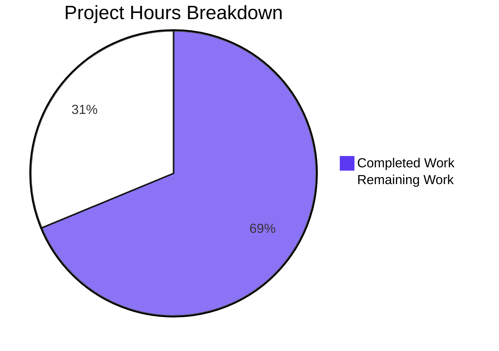

# 1. Executive Summary

## 1.1 Project Overview

This project ports a one-statement Node.js server — `require('http').createServer((req,res)=>res.end('Hello, World!\n')).listen(3000,…)` — to Python 3 on Flask as one new file, `app.py`. Four fixed behaviours are kept byte-faithful: the 14-byte body `Hello, World!` plus a line feed, status 200, port 3000, and the startup line `Server running at http://127.0.0.1:3000/` printed once per start — for every path and each of the nine standard HTTP methods. The repository's Express service, `server.js`, is untouched and nothing from it is reproduced. Technical scope is one 15-line module holding the whole application: one view, two route rules, no manifest, no tests, no configuration.

## 1.2 Completion Status



Completed Work is Dark Blue (#5B39F3); Remaining Work is White (#FFFFFF).

| Metric | Hours |
|---|---|
| Total Hours | 32 |
| Completed Hours (AI + Manual) | 22 |
| Remaining Hours | 10 |

**Completion: 68.75% (69% rounded)** — 22 of 32 hours. All 34 scoped requirements are delivered; the residual 10 hours are path-to-production work (Section 2.2).

## 1.3 Key Accomplishments

- **Any path, all nine methods** — one view answers 200 with the exact 14-byte body (`app.py:7-10`).
- **Static-looking paths too** — the framework's implicit static route is off, so `/static/…` returns the body, not a 404 (`app.py:3`).
- **Byte-exact fidelity** — body (hex `48656c6c6f2c20576f726c64210a`), status 200, port 3000, startup line printed once.
- **One file, no comments** — 15 lines, one import, one view, no handler, no configuration, no manifest.
- **Guarded start** — `python app.py` binds and prints; importing the module does neither (`app.py:13-15`).
- **Superseded service untouched** — `server.js` is byte-identical, undeleted, and none of its behaviour is reproduced.
- **Verified through a browser** — an independent client rendered the exact text everywhere, with no console error.
- **Nothing to hide a defect behind** — no secret, no request-derived value, no injection sink, no reachable debug surface.

## 1.4 Critical Unresolved Issues

Five items remain open; none of the 34 scoped requirements is undelivered.

| Issue | Impact | Owner | ETA |
|---|---|---|---|
| Intended source not confirmed: the port reproduces the quoted one-statement server, not the repository's `server.js`, which also serves `/good-evening` as `text/plain` and 404s everywhere else (`server.js:3-5`, `app.py:10`) | If the repository file was meant, the delivered shape is wrong for the intended contract | Product owner | Before any consumer cut-over |
| No automated protection of the contract: no test framework exists, is configured, or may be added, so nothing in the repository fails if the body, the method list or the routing changes | A silent regression in a fixed behaviour | Engineering / DevOps | With the first CI change (5h) |
| The startup line is not a readiness signal — it is printed immediately before the bind (`app.py:14-15`), so a start that then fails on a busy port still logs "running" | A supervisor could treat a failed start as healthy | Operations | Before supervision is enabled (2h) |
| The once-per-start guarantee depends on the deployment environment: exporting the framework's debug variable enables its reloader and prints the line twice (`app.py:15`) | Duplicate startup output and an interactive debugger reachable on the loopback port | Operations | At deployment (2h) |
| Deliberately unexercised areas: protocol-/process-level behaviour (malformed framing, protocol versions, chunked encoding, header limits, `Expect: 100-continue`, signal handling), the non-standard verb table, and the superseded Node service itself | Behaviour under malformed or unusual traffic is unknown; consumers of the old service have no runtime comparison | Engineering | On demand, if exposure beyond loopback is required |

## 1.5 Access Issues

No access issues identified. The application needs no credential, database, external service or environment variable, and binds a loopback interface only; building it needs only a public package index for the two pins.

## 1.6 Recommended Next Steps

1. **[High]** Confirm the quoted one-statement server, not the repository's Express file, is the intended source.
2. **[High]** Add the acceptance gate to CI so the fixed behaviours cannot regress (5h).
3. **[Medium]** Pin CPython 3.15.2 with flask 3.1.3 and werkzeug 3.1.9 in the deployment image (3h).
4. **[Medium]** Put the service under a process manager with an HTTP readiness probe and clean environment variables (2h).
5. **[Low]** Keep the loopback bind; wider exposure needs an edge proxy for TLS and headers.

# 2. Project Hours Breakdown

## 2.1 Completed Work Detail

| Component | Hours | Description |
|---|---|---|
| Single-file Flask port (`app.py`) | 6 | The application object constructed without the framework's implicit static route; the one-line list of the nine accepted methods; both `/` and `/<path:path>` registered on the one view that returns the fixed body; the guarded start that prints the fixed line before `app.run(port=3000)` |
| Path-parity closure (`app.py:3`) | 2 | Passing `static_folder=None` and proving it: the whole `/static` family returns the fixed body, the routing table holds exactly the two designed rules, and the file's 15-line, single-file, comment-free shape is unchanged |
| Fidelity verification against the pinned framework | 3 | Establishing body bytes, implicit status, the bound port and the once-per-start line from Flask 3.1.3 / Werkzeug 3.1.9 documented behaviour at those versions rather than from framework defaults in general |
| Contract verification, run by hand | 5 | 24 path shapes, nine verbs on two paths including raw-socket `CONNECT`/`TRACE`, byte digests on every response, `HEAD` and `OPTIONS` response detail, startup-line counts under traffic, import inertness, and end-to-end checks through an independent browser |
| Static quality and security assessment | 3 | Comment-free and placeholder-free file; no secret, no request-derived value, no injection sink; debug surface unreachable; dependency advisories checked at the pinned versions |
| Scope-boundary verification | 2 | Nothing carried over from the Express baseline; the baseline byte-identical and undeleted; no manifest, test, documentation, configuration, container or CI artefact anywhere in the tree |
| Environment build and pins | 1 | The isolated CPython 3.15.2 environment with flask 3.1.3 and werkzeug 3.1.9, and the per-change compile check |
| **Total** | **22** | |

## 2.2 Remaining Work Detail

| Category | Hours | Priority |
|---|---|---|
| Automated acceptance gate outside the repository — script the nine-verb contract loop, the body-byte digest and the baseline parse check, and run them in CI so the fixed behaviours cannot regress | 5 | High |
| Reproducible pinned runtime for deployment — encode CPython 3.15.2 with flask 3.1.3 and werkzeug 3.1.9 in the deployment image or pipeline (the repository may carry no manifest) and re-run the gate there | 3 | Medium |
| Operational run-book and supervision — a restarting process manager, unbuffered log capture, an HTTP readiness probe instead of the printed line, an environment that never exports the framework's debug variable, and a record of the accepted framework defaults | 2 | Medium |
| **Total** | **10** | |

## 2.3 Hours Calculation and Assumptions

Completion is hours-based and covers only the work this project was scoped against plus the path-to-production work its deployment needs:

- Completed hours: 6 + 2 + 3 + 5 + 3 + 2 + 1 = **22**
- Remaining hours: 5 + 3 + 2 = **10**
- Total project hours: 22 + 10 = **32**
- Completion: 22 ÷ (22 + 10) × 100 = 68.75%, shown as 69% when rounded

Assumptions and confidence: the completed figure is an engineering estimate of the delivered work — implementation of a contract that is one line in its source but needs three non-obvious decisions in Python, plus the verification effort that proves it (24 path shapes, nine verbs, byte digests, guarded start, browser checks). Confidence in it is **high**: the artefact is 15 lines with a 15-line diff, and every counted behaviour was exercised directly. Confidence in the remaining items is **high** for the pinned runtime (a mechanical change to a deployment definition) and **medium** for the CI gate and the run-book (2 hours each of the residual work is contingency for wiring the gate into an existing pipeline and for choosing a process manager). No remaining hour is costed for hardening — TLS, security headers, rate limiting or a production WSGI server — because this change explicitly excludes it; that work appears as a deployment recommendation in Section 8 and as a risk in Section 6.

# 3. Test Results

This project binds no test framework: there is no test file, runner, fixture or coverage tool in the tree, and the work's own constraints forbid adding one. The results below are therefore the contract checks that were executed against the running service and the tree, and the Coverage column carries no value because nothing measures it. Every row is a check that was run and whose result was observed; no row lists a test that was not executed.

| Area / Category | Framework | Tests | Passed | Failed | Coverage | What This Proves |
|---|---|---|---|---|---|---|
| Contract gate — nine verbs on `/`, body-byte digest, baseline parse check | None bound to the project; `curl`, `od` and Node's parser | 11 | 11 | 0 | n/a | The gate this project defines for itself passes exactly as written: every verb line `200 14` (HEAD `200 0`), the digest `48656c6c6f2c20576f726c64210a`, and the untouched baseline still parses |
| Path coverage — 24 shapes: nested, trailing slash, query string, percent-encoded, `/static` family, file look-alikes, the superseded route path | `curl` | 24 | 24 | 0 | n/a | Every path reaches the one view and returns the fixed 14-byte body with status 200 and no redirect — including the static-looking prefix, where a framework default would otherwise answer instead |
| Method surface on a nested path, plus `HEAD` and `OPTIONS` response detail | `curl`, including raw-socket `CONNECT` and `TRACE` | 11 | 11 | 0 | n/a | All nine standard verbs reach the one view; `OPTIONS` carries the real entity body rather than an empty automatic answer, and `HEAD` returns headers only with `Content-Length: 14` |
| Superseded-service non-carry-over — the old route path, an undeclared path, absence of the framework error page | `curl` and `od` | 3 | 3 | 0 | n/a | The service does not inherit the Express baseline's route text or its framework 404; unknown paths answer with the fixed body |
| Application-object and routing-table introspection — rules, endpoints, method sets, static folder, debug flag | CPython, in process | 6 | 6 | 0 | n/a | There is one response producer: exactly two rules on one endpoint, no framework static rule, and no debug surface armed |
| Guarded start and import inertness | CPython in a private network namespace | 2 | 2 | 0 | n/a | `python app.py` binds and serves; importing the module prints nothing, binds nothing and writes nothing into the checkout |
| Startup output counts, and the startup-failure path | `grep` over the captured streams; CPython with the port held | 4 | 4 | 0 | n/a | The fixed line appears exactly once per start on stdout and never on stderr; a second instance on a busy port prints it once and exits 1 with a clear "Address already in use" message |
| Browser end-to-end — four navigations, a 14-pair in-page fetch matrix, console and network inventory | Headless Chrome, driven as an independent client | 18 | 18 | 0 | n/a | A real browser sees the same body, status and length on every path and verb it can send, with zero console errors and no failed request |
| **Total** | | **79** | **79** | **0** | | |

**Not Covered**

- **No automated test suite exists, and none may exist.** Every result above comes from checks run by hand against the running service; nothing in the repository would fail if the body, the method list, the routing or the port changed. This is the single largest residual exposure and is costed in Section 2.2.
- **Protocol- and process-level behaviour was never exercised and is outside the contract:** malformed request framing, HTTP protocol versions, chunked-encoding edge cases, header-count and header-size limits, `Expect: 100-continue`, and signal handling at shutdown.
- **Verbs beyond the nine standard ones were never exercised** — the roughly three dozen non-standard verbs are neither registered nor tested, so behaviour for them is unknown (an undeclared verb is refused by the framework's router).
- **The superseded Node service was never started.** Its dependencies were never installed and it cannot bind the same port; its behaviour is known only by reading `server.js`, which is why the intended-source question in Section 1.4 is still open.
- **No load, latency, throughput or resource-exhaustion measurement was made**, and no performance expectation exists for this contract.
- **No dependency scanner is bound to the project.** The two pinned packages were checked against known advisories by hand; there is no automated vulnerability gate.
- **There is no user interface to test** — no screens, forms, client-side state or assets — so no UI coverage applies.

# 4. Runtime Validation & UI Verification

The service was driven end to end from a freshly built environment — CPython 3.15.2 with Flask 3.1.3 and Werkzeug 3.1.9, started with `python app.py` from the repository root and bound to 127.0.0.1:3000 — through `curl` and raw sockets, through an in-process read of the live application object, and through an independent headless browser as a second client.

- ✅ **Start-up and bind** — `python app.py` binds 127.0.0.1:3000, prints the fixed startup line exactly once on stdout and nothing on stderr, and spawns no child process.
- ✅ **Any-path routing** — 24 path shapes (nested, trailing-slash, query-string, percent-encoded, `/static/…`, file look-alikes, the superseded route path) all return 200 with the 14-byte body and 0 redirects.
- ✅ **Method surface** — all nine standard verbs reach the one view on both `/` and a nested path; `OPTIONS` carries the real body and `HEAD` answers with headers only.
- ✅ **Fixed body and status** — every response is byte-exact `Hello, World!\n` (hex `48656c6c6f2c20576f726c64210a`) with status 200 and no redirect anywhere.
- ✅ **Single response producer** — the routing table holds exactly `/` and `/<path:path>` on one endpoint, with no framework static rule and no second place the body is produced.
- ✅ **Guarded start** — importing the module prints nothing and binds nothing (in a clean network namespace, a connect afterwards is refused).
- ✅ **Superseded service not reproduced** — `/good-evening` returns the fixed body, an undeclared path returns 200, and the Express route's text and the framework's error page appear nowhere.
- ✅ **Browser end-to-end (independent client)** — four navigations and a 14-pair in-page fetch matrix all returned 200 with `Content-Length: 14`, the text `Hello, World!\n`, zero console errors and no failed request.
- ✅ **Startup-failure path** — a second instance started while port 3000 is held prints the fixed line once and exits with status 1 and a clear "Address already in use" message on stderr.
- ⚠ **Never exercised at runtime** — protocol- and process-level behaviour (malformed framing, protocol versions, chunked encoding, header limits, `Expect: 100-continue`, signal handling), verbs outside the nine, the superseded Node service (never started, and unable to share the port), and any load, latency or throughput measurement. The application also exposes no user interface — no screens, forms, client-side state or assets — so no screen or user-journey verification applies.

# 5. Compliance & Quality Review

This review maps every deliverable this project was scoped to against the standard it was built to satisfy, and sets out the state each one stands in now.

## 5.1 Compliance Matrix

| # | Deliverable | Benchmark | Status | Evidence |
|---|---|---|---|---|
| 1 | Deliverable set — one new file, `app.py`, and the baseline left alone | Scope discipline: no path created, edited, renamed or deleted beyond the named deliverable | ✅ PASS | The branch adds exactly one path (`A app.py`, +15 lines); `server.js` is byte-identical (sha256 `5189860f…f18c12`) and undeleted |
| 2 | Source discipline — nothing carried over from the superseded service | The quoted implementation is the only source of truth, and a mismatch in the repository is surfaced rather than worked around | ✅ PASS | No Express token, route, media type or framework default exists in `app.py`; the mismatch is stated and the quoted source kept authoritative |
| 3 | Any-path coverage | Every path is answered by the one view, with no path family excluded | ✅ PASS | 24 path shapes, including the whole `/static/…` family, all 200 / 14 bytes / 0 redirects |
| 4 | Method surface — exactly the nine standard verbs | The nine verbs are registered and reachable; no verb outside them is registered | ✅ PASS | Registered method union is exactly the nine with no extras; `OPTIONS` carries the body, `HEAD` is header-only |
| 5 | Fixed body, byte-for-byte | `Hello, World!` plus one line feed, 14 bytes, nothing after it | ✅ PASS | Every captured body is hex `48656c6c6f2c20576f726c64210a`; one digest across all bodies |
| 6 | Status 200 with no redirect | 200 on every response, no redirect anywhere | ✅ PASS | Every response observed is 200; redirect count 0 on all shapes |
| 7 | Port and bind | Port 3000, no configuration read and no override hook | ✅ PASS | `app.run(port=3000)`; listener on 127.0.0.1:3000; framework default port unused |
| 8 | Startup line and guarded start | The fixed line printed once per start; the application startable from the single documented command and inert on import | ✅ PASS | Line count 1 on stdout, 0 on stderr, unchanged under traffic; import prints nothing and binds nothing |
| 9 | One response producer | Both rules resolve to the same view, the only place the body is produced | ✅ PASS | Rules `['/', '/<path:path>']`, one endpoint, one `return`; no static route registered |
| 10 | Code quality and shape | Comment-free, dead-code-free, placeholder-free single-file form; no artefact beyond the deliverable | ✅ PASS | 15 lines, 0 comment bytes, one import, one view; no manifest, test, documentation, configuration, container or CI file exists |
| 11 | Security posture of the delivered code | No secret, no request-derived value, no injection sink, no debug surface | ✅ PASS | No credential pattern; the view reads no request attribute; the framework debugger is unreachable; pins carry no known advisory |
| 12 | Verification of the fixed behaviours | The four fixed behaviours verified against the framework's documented behaviour at the pinned versions | ✅ PASS | Each behaviour traced to Flask 3.1.3 / Werkzeug 3.1.9 documented behaviour and re-exercised at those versions |

## 5.2 AAP & Rule Divergences and Gaps

No user rules were supplied for this project, so nothing diverges from a user rule. One departure from the plan was taken, and it is recorded here in full.

| What the AAP/Rule Required | What Was Delivered Instead | Why It Diverged | Impact | Remediation |
|---|---|---|---|---|
| The illustrative listing of the file fixes `app = Flask(__name__)` as line 3 of a 15-line, comment-free `app.py` | `app = Flask(__name__, static_folder=None)` at `app.py:3` — the same line with one keyword argument added | The listing's literal and the plan's own request-fixed goal — "a response on every path" — cannot both hold. With the default static folder, the framework registers its own `/static/<path:filename>` rule, which outranks the catch-all and answers that path family with a 207-byte error page and an empty `OPTIONS` body. The project's setup instruction names this exact remedy while requiring the single-file, comment-free shape to be kept, and the goal outranks an illustrative listing | Positive: it is what makes the path-coverage goal true — the `/static/…` family now returns the fixed 14-byte body on all six measured shapes, while the file stays 15 lines, single-file, comment-free, with one view, no handler and no configuration. The only cost is that the file no longer matches the illustrative listing character for character | None owed. Keep the line: reverting it reopens the gap. A future editor comparing the file against the listing should treat the difference as settled, not as a tidy-up opportunity |

**Why this departure was the right settlement.** The two statements cannot both be satisfied, so one of them had to give, and the choice was made in favour of the requirement that came from the request itself rather than from an illustration of how to satisfy it. The evidence is directly observable: the request's contract is a response on every path, and before the extra keyword argument the `/static/…` family answered with the framework's own 404 page — a second response producer that the plan elsewhere forbids. After it, the routing table holds exactly the two designed rules and one endpoint (`app.py:3,7-8`), every one of the 24 path shapes tested returns 200 with the fixed body, and the `OPTIONS` verb carries the real entity instead of an empty automatic answer. Nothing else about the deliverable moved: still 15 lines, 392 bytes, no comment, no handler, no configuration, no manifest, and the baseline untouched. No human decision is required to accept it, and none is required to keep it — but anyone tempted to restore the literal should first re-read Section 3's coverage results and Section 6's first risk, because reverting the keyword is the one edit that silently breaks the contract this project exists to deliver.

# 6. Risk Assessment

Risks below are forward-looking: what could still go wrong once this service is deployed or relied upon.

| Risk | Category | Severity | Probability | Mitigation | Status |
|---|---|---|---|---|---|
| Nothing in the repository protects the contract, so a later edit to the body literal, the method list, the routing or the port could break a fixed behaviour with no failing check | Technical | Medium | Medium | Stand up the acceptance gate outside the repository and run it on every change (Section 2.2, 5h) | Open — the single largest residual exposure |
| A deployment environment that exports the framework's debug variable enables its reloader and interactive debugger, printing the startup line twice and exposing a console on the loopback port | Security | High | Low | Deploy with a clean environment that sets no framework variable; verify the startup line appears exactly once after each deployment | Open — accepted caveat, no settlement available inside the file |
| The runtime pins — CPython 3.15.2 with flask 3.1.3 and werkzeug 3.1.9 — are recorded nowhere in the repository, so a rebuild elsewhere could resolve different framework versions and change default behaviour | Technical | Medium | Medium | Encode the three pins in the deployment image and re-run the acceptance gate there (3h) | Open |
| The service runs the framework's development server with no TLS, no security headers, no rate limiting and no request-size limit, bound to loopback only | Security / Operational | High if exposed beyond loopback, Low as delivered | Low | Keep the loopback bind; if the service must be reachable more widely, terminate TLS, add headers and limits at an edge, or move it to a production WSGI server — work this change explicitly excludes | Open by design |
| Consumers of the superseded service expect behaviour this service does not provide: `/good-evening` returns the fixed greeting here, and unknown paths return 200 rather than a 404 page | Integration | Medium | Medium | Settle the intended-source question (Section 1.4) before any cut-over and update consumers accordingly | Open |
| The startup line is a log message rather than a readiness signal — it is printed immediately before the bind — so a start that then fails on a busy port still logs "running" | Operational | Low | Medium | Supervise on process state and probe readiness over HTTP instead of parsing the line (2h) | Open |
| There is no observability beyond the framework's own access lines: no health endpoint, metrics, tracing or log configuration exists, so a silent failure is invisible from inside the process | Operational | Low | Medium | External supervision, heartbeat probing and log capture; adding in-process telemetry is excluded by this change's constraints | Open by design |
| Protocol- and encoding-level behaviour — malformed framing, unusual protocol versions, chunked encoding, header limits, `Expect: 100-continue`, signal handling — is unverified, as are the non-standard HTTP verbs | Technical | Low | Low | Accept as outside the contract; keep a reverse proxy in front if the service is ever exposed beyond loopback, so malformed traffic is rejected before it reaches the application | Accepted — outside the verified contract |

# 7. Visual Project Status


Completed Work is shown in Dark Blue (#5B39F3) and Remaining Work in White (#FFFFFF). The figures are the same ones carried in Section 1.2 and itemised in Section 2.2.

| Status | Hours | Share of total |
|---|---|---|
| Completed Work | 22 | 68.75% |
| Remaining Work | 10 | 31.25% |
| **Total** | **32** | **100%** |

**Remaining Hours by Category**

| Category | Hours | Priority |
|---|---|---|
| Automated acceptance gate outside the repository | 5 | High |
| Reproducible pinned runtime for deployment | 3 | Medium |
| Operational run-book and supervision | 2 | Medium |
| **Total** | **10** | |

**Where the Completed Hours Went**

| Area | Hours | Of the 22 completed |
|---|---|---|
| Implementation — the single-file port and the path-parity closure | 8 | 8 of 22 |
| Verification — fidelity analysis, contract checks, browser checks | 8 | 8 of 22 |
| Quality and security assessment, scope-boundary verification, environment build | 6 | 6 of 22 |
| **Total** | **22** | **22 of 22** |

# 8. Summary & Recommendations

The project delivered exactly what it set out to: a single 15-line file, `app.py`, that ports a one-statement Node.js server to Python 3 on Flask while holding four fixed behaviours byte-faithful — the 14-byte body `Hello, World!` plus a line feed, status 200, port 3000, and the startup line `Server running at http://127.0.0.1:3000/` printed once per start — for every path and each of the nine standard HTTP methods. The superseded Express service in `server.js` is untouched and undeleted, nothing from it is reproduced, and the file carries no comment, no handler, no configuration, no manifest and no second response path. The one departure from the illustrative listing — `app = Flask(__name__, static_folder=None)` at `app.py:3` — exists because it is what makes "a response on every path" true: without it the framework's own static rule answers the `/static/…` family with a 207-byte error page instead of the fixed body (Section 5.2).

Everything claimed above was exercised rather than assumed. 79 contract checks were run against the running service and the tree and all 79 passed: the nine-verb gate with its body-byte digest and the baseline parse check, 24 path shapes, nine verbs on two paths including raw-socket `CONNECT` and `TRACE`, `HEAD` and `OPTIONS` response detail, routing-table introspection, guarded start and import inertness, startup-line counts under traffic, the startup-failure path, and a browser driving navigations and an in-page fetch matrix as an independent client. Nothing failed, no response redirected, no error page appeared anywhere, and no console error was raised.

**Completion stands at 68.75% (69% rounded)** — 22 of 32 hours. All 34 scoped requirements are delivered; the residual 10 hours are path-to-production work only: an acceptance gate outside the repository so the fixed behaviours cannot regress (5 hours, High), the pinned runtime encoded into a deployment image (3 hours, Medium), and an operational run-book with process supervision and a readiness probe (2 hours, Medium, Section 2.2). Nothing remains to be built inside the application itself: the file is complete, and the only divergence is settled.

| Metric | Value |
|---|---|
| Completion (AAP-scoped, hours-based) | 68.75% (69% rounded) |
| Total project hours | 32 |
| Completed hours | 22 |
| Remaining hours | 10 |
| Contract checks executed / passed | 79 / 79 |
| Requirements delivered | 34 of 34 |
| Path shapes verified | 24 |
| Standard HTTP methods verified | 9 of 9 |
| Divergences from the plan or user rules | 1, settled, needing no human work |
| Open release-relevant items | 5 (Section 1.4) |

The critical path to production is short and mostly outside the code. First, settle the intended source: the port reproduces the quoted one-statement server, while the repository's `server.js` also serves `/good-evening` as `text/plain` and answers everything else with its framework's 404 — if that file was the intended contract, the delivered shape is wrong for it, and no amount of hardening fixes the wrong contract (Section 1.4, first row). Second, put the acceptance gate into CI so the four fixed behaviours are protected by a pipeline rather than by memory (5 hours). Third, pin CPython 3.15.2 with flask 3.1.3 and werkzeug 3.1.9 in the deployment image and re-run the gate there, since the repository carries no manifest (3 hours). Fourth, put the service under a process manager with an HTTP readiness probe, unbuffered log capture, and a deployment environment that never exports the framework's debug variable (2 hours). The first of those four is a decision, not work; the other three are the 10 remaining hours.

Success is measurable and already demonstrated: a response on every path and on each of the nine verbs with the exact 14 bytes and status 200; the startup line appearing exactly once per start on stdout and never under traffic; the application starting from the single documented command while importing it does nothing; the baseline file byte-identical; and no secret, no request-derived value and no reachable debug surface in the deliverable. The one measurement that cannot be made in this repository is a regression signal — there is no test suite and none may be added — which is precisely why the CI gate is the highest-priority remaining task.

**Production readiness: ready within its stated purpose, not as a hardened public service.** Judged against the contract it was built to satisfy, nothing is missing: it boots from one command, binds the port its startup line names, serves the exact body for every path and method, writes nothing, discloses nothing and reads no configuration. Judged as something to expose beyond a loopback interface, it is deliberately thin — a development server, no TLS, no security headers, no rate limiting — and that thinness is the change's own constraint rather than an oversight (Section 6). Keep it on loopback, or put it behind an edge that supplies the protections it does not have.

# 9. Development Guide

## 9.1 System Prerequisites

- A POSIX shell (Linux, macOS or WSL). No compiler, build tool or system package beyond those below is needed.
- **`uv` 0.13.x** (the recommended path) **or** a Python ≥ 3.13 interpreter with `pip` for the fallback path.
- **CPython 3.15.2** — `uv` downloads it on demand. Flask 3.1.3 declares `>=3.9`, and the fallback path was exercised on CPython 3.13.18, so either interpreter runs the application.
- **`curl`** and **`od`** for the contract checks (this host has no `xxd`; `od -An -tx1` is the substitute).
- **Node.js** only for the one-line parse check of the untouched baseline file; the application itself never uses it.
- **No** database, message broker, cache, queue, container runtime, external service, credential or environment variable is involved. Nothing is read from the environment at any point.
- **Port 3000 on the loopback interface** must be free. No other port is used, and the port cannot be reconfigured — it is a literal in the source.

## 9.2 Environment Setup and Dependency Installation

The repository deliberately carries no dependency manifest, so the pins below are authoritative; do not add a `requirements.txt`, `pyproject.toml`, lock file or `.gitignore`.

```bash
cd <repository root>

# Recommended path: uv-managed pinned interpreter and environment
uv venv --python 3.15.2 .venv
uv pip install --python .venv/bin/python flask==3.1.3 werkzeug==3.1.9

# Fallback if uv is unavailable
/usr/bin/python3.13 -m venv .venv
.venv/bin/pip install flask==3.1.3 werkzeug==3.1.9
```

Expected output of the install: the pinned set resolving to `flask 3.1.3`, `werkzeug 3.1.9` and the transitive packages `jinja2 3.1.6`, `click 8.5.0`, `itsdangerous 2.2.0`, `blinker 1.9.0`, `markupsafe 3.0.4`. Confirm afterwards:

```bash
.venv/bin/python -c "import sys, importlib.metadata as m; print(sys.version.split()[0], m.version('flask'), m.version('werkzeug'))"
# expected: 3.15.2 3.1.3 3.1.9
```

The `.venv` directory is self-ignoring and must never be committed, and neither may `node_modules`, if you install the Node baseline for the parse check:

```bash
CI=true npm install --no-package-lock --no-audit --no-fund
```

## 9.3 Application Startup

One command starts the whole application. Run it from the repository root, with `-u` so the startup line is not held in a pipe buffer:

```bash
cd <repository root>
.venv/bin/python -u app.py
```

Expected output on stdout — exactly three lines, in this order (the first is this application's; the next two are the framework's own banner, which is expected):

```
Server running at http://127.0.0.1:3000/
 * Serving Flask app 'app'
 * Debug mode: off
```

The framework additionally writes a development-server advisory, a ` * Running on http://127.0.0.1:3000` line and one access line per request to stderr. Stop the service with `Ctrl+C`, or, if you backgrounded it, with the pid that owns the port: `kill $(lsof -ti tcp:3000 -sTCP:LISTEN)` where `lsof` exists, otherwise the pid you started. Never start it in the foreground of a shared shell.

## 9.4 Verification Steps

Run these after any change; each was executed and produced the output shown.

```bash
# 1. The contract gate: nine verbs on the root path
for M in GET HEAD POST PUT DELETE CONNECT OPTIONS TRACE PATCH; do \
  curl -s -o /dev/null -X $M -w "$M %{http_code} %{size_download}\n" http://127.0.0.1:3000/; done
# expected: GET 200 14, HEAD 200 0, and the other seven 200 14 — every line as required

# 2. The body, byte for byte (14 bytes, "Hello, World!" plus one line feed)
curl -s http://127.0.0.1:3000/ | od -An -tx1 | tr -d ' \n'; echo
# expected: 48656c6c6f2c20576f726c64210a

# 3. The untouched baseline still parses
node --check server.js
# expected: no output, exit status 0

# 4. The deliverable compiles
.venv/bin/python -m py_compile app.py && rm -rf __pycache__
# expected: exit status 0 — remove __pycache__, which is build output and not part of the deliverable
```

Two further self-checks read the live application object without starting a server:

```bash
.venv/bin/python -c "import app; print(sorted(str(r) for r in app.app.url_map.iter_rules())); print(sorted(app.app.view_functions)); print(app.app.has_static_folder)"
# expected: ['/', '/<path:path>']  ['hello']  False

.venv/bin/python -c "import app; print(app.METHODS)"
# expected: the nine verbs, in this order: GET HEAD POST PUT DELETE CONNECT OPTIONS TRACE PATCH
```

## 9.5 Example Usage

Every path and every one of the nine verbs returns the same body, so any of these is a valid smoke test.

```bash
curl -i http://127.0.0.1:3000/
```

```text
HTTP/1.1 200 OK
Server: Werkzeug/3.1.9 Python/3.15.2
Content-Type: text/html; charset=utf-8
Content-Length: 14
Connection: close

Hello, World!
```

```bash
# A nested path, matched by the catch-all rule, with no redirect
curl -s --path-as-is http://127.0.0.1:3000/deep/nested/path | od -An -c

# A static-looking path: served by the same view, not by a filesystem lookup
curl -s --path-as-is http://127.0.0.1:3000/static/app.css | od -An -tx1 | tr -d ' \n'; echo

# A non-GET verb, and OPTIONS, which returns the real body rather than an empty answer
curl -s -X PATCH   http://127.0.0.1:3000/anything | od -An -tx1 | tr -d ' \n'; echo
curl -s -X OPTIONS --path-as-is http://127.0.0.1:3000/static/x.txt | od -An -tx1 | tr -d ' \n'; echo

# HEAD is header-only, as the protocol requires: the length is announced, no body follows
curl -sI http://127.0.0.1:3000/
```

All of the above produce the same digest: `48656c6c6f2c20576f726c64210a`.

## 9.6 Troubleshooting

| Symptom | Cause | Resolution |
|---|---|---|
| `Address already in use` / "Port 3000 is in use by another program" — printed **after** the fixed startup line | The port is held by another process. The line is printed before the bind, so a "running" line does not prove the service is listening | Identify and stop the holder, then start again. The port cannot be changed: it is a literal in `app.py`, and no environment variable or argument overrides it |
| `HTTP 000`, curl exit 7 (connection refused) on port 3000 | Nothing is listening: the service is not running, or has exited | Start it as above; if it exits immediately, read stderr for the bind error |
| Nothing answers on port 5000 | Expected — 5000 is the framework's default port and this application does not use it | Use 3000 |
| The startup line never appears in a redirected log file | Python block-buffers stdout when it is not a terminal | Start with `-u` (or `stdbuf -oL`) |
| The startup line appears **twice** | The environment exports the framework's debug variable, which turns on the reloader (a child re-executes the module) and enables the interactive debugger | Unset that variable before starting; a deployment environment must not export any framework variable |
| `AttributeError: module 'werkzeug' has no attribute '__version__'`, or a `DeprecationWarning` for `flask.__version__` | Those attributes are gone or deprecated in the pinned versions | Use `importlib.metadata.version('flask')` and `importlib.metadata.version('werkzeug')` |
| `xxd: command not found` | Not installed on this host | Use `od -An -tx1` |
| `ModuleNotFoundError: No module named 'flask'` | The system interpreter was used instead of the environment | Always invoke `.venv/bin/python` |
| A `__pycache__` directory or `.pyc` file appears in the repository | `py_compile` or a plain `import` wrote bytecode inside the checkout | Remove it, and run imports with `PYTHONDONTWRITEBYTECODE=1` or `PYTHONPYCACHEPREFIX=<path outside the repository>`; never commit `.venv`, `node_modules` or bytecode |
| `lsof`, `ss` and `netstat` show no listener while the service answers | Those tools are absent here and do not reliably enumerate listeners in this environment | Probe by connecting: `curl -s -o /dev/null -w '%{http_code}\n' http://127.0.0.1:3000/` — connection refused means the port is free |

## 9.7 Rules To Preserve When Editing

Any change to this service must keep the shape the contract depends on: one file (`app.py`), no comments, one view, both route rules and all nine methods, the body literal written exactly once, the startup literal written once, `port=3000` written once, no 404 or error handler, no configuration read, and no manifest, test file, `README` or `.gitignore` added. Do not modify or delete `server.js`, and do not remove `static_folder=None` from line 3 — that keyword argument is what keeps the `/static/…` family inside the contract rather than in the framework's own error page (Section 5.2).

# 10. Appendices

## Appendix A — Command Reference

| Purpose | Command |
|---|---|
| Create the pinned environment (`uv`) | `uv venv --python 3.15.2 .venv` |
| Install the pinned dependencies | `uv pip install --python .venv/bin/python flask==3.1.3 werkzeug==3.1.9` |
| Create the environment without `uv` | `/usr/bin/python3.13 -m venv .venv && .venv/bin/pip install flask==3.1.3 werkzeug==3.1.9` |
| Start the service | `.venv/bin/python -u app.py` |
| Contract gate — nine verbs | `for M in GET HEAD POST PUT DELETE CONNECT OPTIONS TRACE PATCH; do curl -s -o /dev/null -X $M -w "$M %{http_code} %{size_download}\n" http://127.0.0.1:3000/; done` |
| Body digest | `curl -s http://127.0.0.1:3000/ \| od -An -tx1 \| tr -d ' \n'` |
| Compile check | `.venv/bin/python -m py_compile app.py` |
| Baseline parse check | `node --check server.js` |
| Routing-table self-check | `.venv/bin/python -c "import app; print(sorted(str(r) for r in app.app.url_map.iter_rules())); print(sorted(app.app.view_functions)); print(app.app.has_static_folder)"` |
| Version check | `.venv/bin/python -c "import importlib.metadata as m; print(m.version('flask'), m.version('werkzeug'))"` |
| Port-free probe | `curl -s -o /dev/null -w '%{http_code}\n' http://127.0.0.1:3000/` (connection refused = free) |
| Stop the service | `Ctrl+C`, or `kill $(lsof -ti tcp:3000 -sTCP:LISTEN)` where `lsof` exists |
| Clean build output | `rm -rf __pycache__` |

## Appendix B — Port Reference

| Port | Interface | Used by | Notes |
|---|---|---|---|
| 3000 | 127.0.0.1 | The application | Bound by `app.run(port=3000)` (`app.py:15`). Hardcoded; no configuration or environment variable can change it |
| 5000 | — | Not used | The framework's documented default, deliberately not in play; connecting to it is refused while the service runs |

The bind is loopback-only: a connection to any non-loopback address of the host on port 3000 is refused.

## Appendix C — Key File Locations

| Path | Role |
|---|---|
| `app.py` | The entire deliverable — 15 lines: one import, the application object, the nine-verb method list, two route rules on one view returning the fixed body, and the guarded start |
| `server.js` | The superseded Express service — present, byte-identical, never modified, never deleted, never executed |
| `package.json` | The Node manifest for the superseded service — unchanged; declares only `express ^5.0.0` |
| `README.md` | Pre-existing repository readme — unchanged |
| `.venv/` | The local pinned environment — self-ignoring, must never be committed |
| `node_modules/` | Only present if you installed the Node baseline for the parse check — must never be committed |

## Appendix D — Technology Versions

| Component | Version | Source of the pin |
|---|---|---|
| CPython | 3.15.2 | The interpreter the service is verified on (CPython 3.13.18 also runs it) |
| Flask | 3.1.3 | The framework the application is built on; `Requires-Python >=3.9` |
| Werkzeug | 3.1.9 | The WSGI layer Flask delegates to; carries the routing `methods` sequence and the development server |
| Jinja2 | 3.1.6 | Transitive, imported by no application code |
| Click | 8.5.0 | Transitive, imported by no application code |
| itsdangerous | 2.2.0 | Transitive, imported by no application code |
| Blinker | 1.9.0 | Transitive, imported by no application code |
| MarkupSafe | 3.0.4 | Transitive, imported by no application code |
| Node.js | 22.x (host default) | Used only for `node --check server.js` |
| uv | 0.13.x | Optional; creates the pinned interpreter and environment |

No version of any of these is recorded in the repository: the project carries no manifest by design, so these pins must be taken from this guide and applied by the build or deployment step.

## Appendix E — Environment Variable Reference

| Variable | Read by the application | Notes |
|---|---|---|
| *(none)* | No | `app.py` reads no environment variable: no `os.environ`, no `getenv`, no `.env` file, no settings object. The port is a literal and the response is a constant, so nothing can vary with the environment |
| Framework debug variable | No, but it changes framework behaviour | If the deployment environment exports the framework's debug variable, the framework enables its reloader (which re-executes the module and prints the startup line twice) and its interactive debugger on the same loopback port. Keep deployment environments clean of framework variables. Documented here rather than guarded in code, because this change may not add configuration |

## Appendix F — Developer Tools Guide

| Tool | Why you would use it | Notes for this project |
|---|---|---|
| `uv` | Create the pinned interpreter and environment | Fastest path to the pins; `uv venv --python 3.15.2` fetches CPython 3.15.2 |
| `python -m venv` + `pip` | Environment creation where `uv` is unavailable | Verified on CPython 3.13.18 with the same two pins |
| `curl` | Drive the contract; probe the port | Use `-o /dev/null -w '%{http_code} %{size_download}'` for status and length; use `--path-as-is` so unusual paths are sent unnormalised |
| `od -An -tx1` | Inspect response bytes | The portable replacement for `xxd`, which is not installed here |
| `py_compile` | Per-change syntax check | `.venv/bin/python -m py_compile app.py`; clean up `__pycache__` afterwards |
| `node --check` | Confirm the untouched baseline still parses | `node --check server.js` |
| In-process introspection | Read the routing table, endpoints and flags without starting a server | `import app` is inert by design |
| Headless browser | Verify the contract as a real client sees it | Any browser works; the body is rendered as a single line of text and the page raises one informational quirks-mode notice because the body carries no markup |

## Appendix G — Glossary

| Term | Meaning here |
|---|---|
| Catch-all route | The `/<path:path>` rule, which matches any non-empty path including slashes, so one view answers every path |
| The nine verbs | GET, HEAD, POST, PUT, DELETE, CONNECT, OPTIONS, TRACE, PATCH — the full method surface this contract serves |
| Fixed body | `Hello, World!` followed by exactly one line feed: 14 bytes, hex `48656c6c6f2c20576f726c64210a` |
| Startup line | `Server running at http://127.0.0.1:3000/`, printed once per start, immediately before the port is bound |
| Guarded start | The `if __name__ == "__main__":` block: `python app.py` starts the server, importing the module does nothing |
| Single response producer | The one view function both rules resolve to — the only place in the codebase that constructs the body |
| Loopback bind | The socket is bound to 127.0.0.1 only, so the service is not reachable from other hosts |
| Development server | The framework's built-in WSGI server, used here because this change may not add production infrastructure; it is not intended for public exposure |
| Accepted framework default | A framework behaviour this contract does not fix and deliberately leaves alone: the media type and header set, the loopback bind, `HEAD`'s header-only answer, and the development server's banner and access lines |
